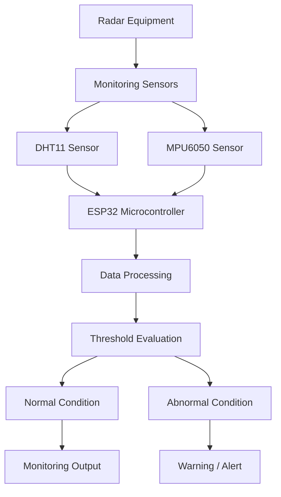

# SMART RADAR EQUIPMENT HEALTH MONITORING SYSTEM

### Intelligent Condition Monitoring for Reliable Radar Equipment

<p align="center">
  <strong>ELEVIUM HACKATHON 2026 | TEAM NO. 03</strong>
</p>

---

## 🚀 Project Overview

The **Smart Radar Equipment Health Monitoring System** is an embedded systems-based solution designed to monitor the operating conditions of radar equipment through continuous temperature, humidity, and vibration measurements.

Radar systems operate in environments where thermal variations, excessive vibration, and environmental conditions can affect equipment reliability and operational stability.

Our solution integrates an **ESP32 microcontroller, DHT11 environmental sensor, and MPU6050 motion sensor** to monitor critical equipment parameters, identify abnormal operating conditions, and support early fault detection.

By combining environmental sensing with motion-based monitoring, the system aims to improve equipment reliability, minimize unexpected failures, and support predictive maintenance practices.

## 🎯 Problem Statement

Radar equipment contains sensitive electronic components that require stable operating conditions. Excessive temperature, humidity variations, and abnormal vibrations can contribute to component degradation and unexpected equipment failures.

Conventional periodic inspection methods may not identify developing abnormalities early enough.

There is a need for a compact, cost-effective, and continuous monitoring solution that can observe critical equipment conditions and provide early warnings when abnormal operating patterns are detected.

## 💡 Our Solution

We propose an embedded monitoring system that collects environmental and motion-related data using multiple sensors.

The ESP32 processes the sensor readings and evaluates them against predefined operating thresholds to identify potentially abnormal conditions.

**Our system focuses on three monitoring parameters:**

- **Temperature Monitoring:** Identifies excessive temperature conditions that may affect electronic components.
- **Humidity Monitoring:** Observes environmental humidity that could contribute to moisture-related equipment issues.
- **Vibration Monitoring:** Detects unusual movement and vibration patterns that may indicate mechanical instability or developing faults.

The system is designed to provide a foundation for intelligent equipment condition monitoring and preventive maintenance.

## ✨ Key Features

- Real-time environmental parameter monitoring.
- Temperature and humidity measurement.
- Vibration and motion monitoring.
- Multi-sensor data acquisition.
- Threshold-based abnormal condition identification.
- Early warning capability for potentially unsafe operating conditions.
- Compact and cost-effective embedded architecture.
- Expandable design for future intelligent fault detection.

## 🏗️ System Architecture



## 🔧 Hardware Components

| Component | Purpose |
|---|---|
| ESP32 Development Board | Main processing and control unit |
| DHT11 Sensor | Temperature and humidity measurement |
| MPU6050 Sensor | Accelerometer and gyroscope-based vibration monitoring |
| LCD Display (if integrated) | Local parameter display |
| LEDs (if integrated) | Visual status indication |
| Breadboard and Jumper Wires | Circuit connections |
| USB Power Supply | Power and programming |

## 💻 Software & Technologies

| Technology | Application |
|---|---|
| Arduino IDE | Embedded programming |
| Embedded C/C++ | Microcontroller programming |
| ESP32 | Sensor data acquisition and processing |
| I2C Communication | MPU6050 sensor communication |
| Digital Communication | DHT11 sensor interfacing |

## ⚙️ Working Principle

1. **Data Acquisition:** The DHT11 collects temperature and humidity readings, while the MPU6050 measures acceleration and angular velocity.

2. **Data Processing:** The ESP32 receives and processes the sensor measurements.

3. **Condition Evaluation:** The collected values are evaluated against predefined thresholds and operating conditions.

4. **Abnormality Identification:** Unusual temperature, humidity, or vibration readings are identified for further attention.

5. **Monitoring and Alerts:** The system provides monitoring information and warning indications through the implemented output interface.

## 🔄 System Workflow

```text
       SYSTEM START
             |
             v
      Initialize ESP32
             |
             v
     Initialize Sensors
             |
             v
    Read Sensor Parameters
             |
             v
    Process Sensor Readings
             |
             v
     Evaluate Conditions
             |
       +-----+-----+
       |           |
       v           v
     NORMAL     ABNORMAL
       |           |
       v           v
   Continue     Generate
   Monitoring   Warning
       |           |
       +-----+-----+
             |
             v
       Repeat Cycle
```

## 🌍 Real-World Applications

- Military and defense radar installations.
- Airport surveillance radar systems.
- Weather monitoring radar stations.
- Industrial radar equipment.
- Electronic equipment enclosures.
- Remote equipment health monitoring systems.

## 🔮 Future Enhancements

Our proposed architecture can be extended with additional intelligent monitoring capabilities:

- **AI-Based Anomaly Detection:** Apply machine learning to identify unusual sensor patterns.
- **IoT Dashboard:** Enable remote monitoring through a web-based interface.
- **Predictive Maintenance:** Analyze historical sensor readings to identify potential equipment degradation.
- **Wireless Notifications:** Send alerts when abnormal operating conditions are detected.
- **Advanced Sensor Integration:** Incorporate additional sensors for current, voltage, and equipment-specific parameters.
- **Data Logging:** Maintain historical records for equipment performance analysis.

## 📁 Repository Structure

```text
ELevium-Hackaton-2026-TeamNo-3/
│
├── Project/
│
├── smart_radar_equipment_health_monitoring/
│
├── smart radar equipment health monitoring.pdf
│
├── Supporting Images and Videos
│
└── README.md
```

## 🚀 Getting Started

### Prerequisites

- ESP32 development board
- DHT11 sensor
- MPU6050 sensor
- Arduino IDE
- Appropriate ESP32 board package
- Required sensor libraries

### Installation

**1. Clone the repository**

```bash
git clone https://github.com/dheerajnathella2007-glitch/ELevium-Hackaton-2026-TeamNo-3.git
```

**2. Navigate to the project directory**

```bash
cd ELevium-Hackaton-2026-TeamNo-3
```

**3. Open the project source code**

Open the relevant ESP32 source file in Arduino IDE.

**4. Configure the hardware**

Connect the DHT11 and MPU6050 sensors to the ESP32 according to the project's circuit configuration.

**5. Install the required libraries**

Install the sensor libraries required by the source code.

**6. Upload and test**

Select the appropriate ESP32 board and COM port, compile the program, and upload it to the development board.

*Note: Refer to the project source files and circuit documentation for the exact pin configuration and library requirements.*

## 👥 Team Information

**Team Name:** ELEVIUM

**Hackathon:** ELevium Hackathon 2026

**Team Number:** 03

**Project:** Smart Radar Equipment Health Monitoring System

**Domain:** Embedded Systems | IoT | Equipment Health Monitoring

## 🏁 Conclusion

The Smart Radar Equipment Health Monitoring System demonstrates how embedded sensing and intelligent condition evaluation can contribute to more reliable radar equipment operation.

By integrating environmental and vibration monitoring into a unified architecture, our solution establishes a foundation for continuous equipment health assessment and early identification of abnormal conditions.

**Our objective is simple: Move from periodic inspection towards continuous, intelligent equipment health monitoring.**

---

<p align="center">
  <strong>ELEVIUM HACKATHON 2026 | TEAM 03</strong>
  <br/>
  Engineering smarter monitoring. Building more reliable systems.
</p>
